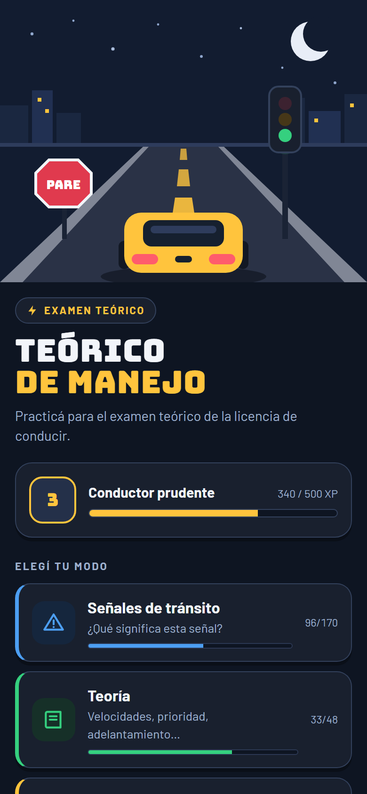
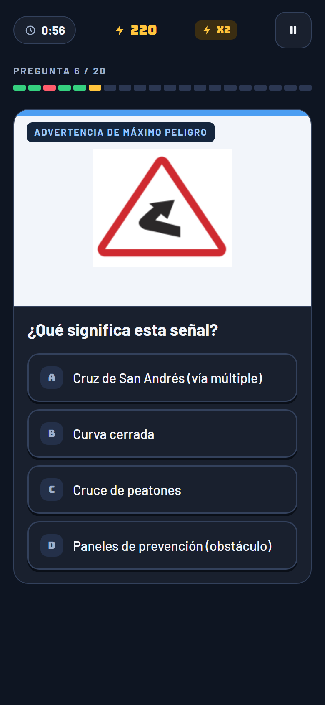
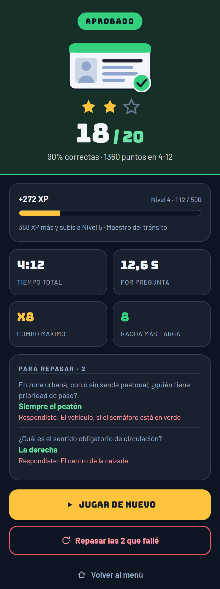
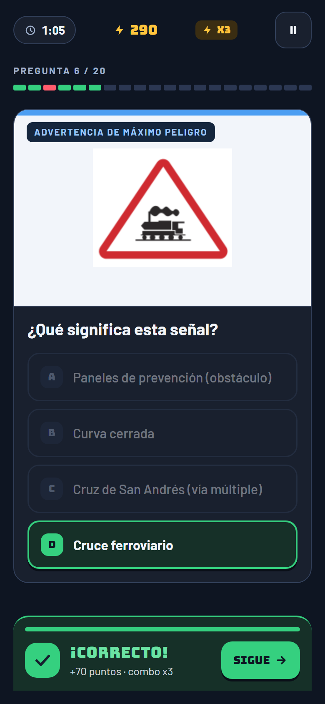
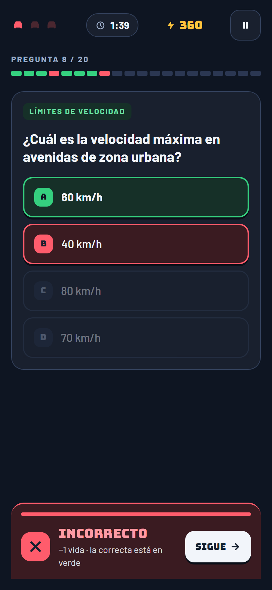
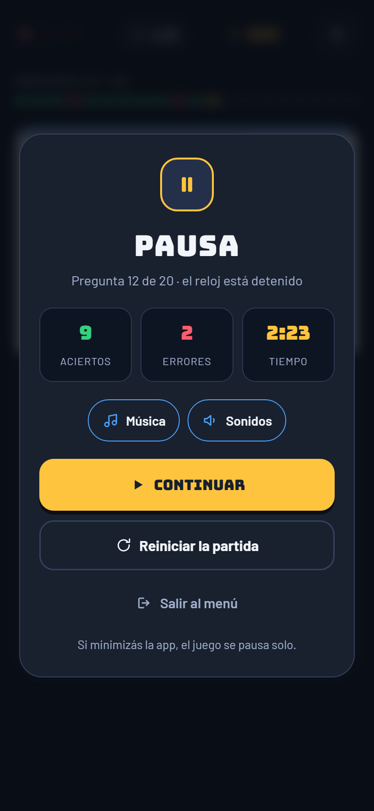

# Teórico de Manejo 🚦

Juego web de preguntas con opción múltiple para **estudiar el examen teórico de la licencia de conducir para autos** (Argentina). Se juega en el celular o en la compu, no necesita instalación ni conexión a un servidor, y está pensado para que estudiar sea más ágil: respondés, ves al instante si acertaste y pasás sola a la siguiente pregunta.

Tiene **170 señales de tránsito** con su imagen y **48 preguntas de teoría** (velocidades, prioridad de paso, adelantamiento, estacionamiento, balizas y más), con puntos, combos, niveles, examen simulado con vidas, música y efectos de sonido.

<p align="center">
  
  
  
</p>

---

## ¿De qué se trata?

El examen teórico tiene dos partes que hay que saberse de memoria: **qué significa cada señal** y **las normas generales de circulación**. Este juego toma el material oficial de estudio y lo convierte en preguntas de opción múltiple:

- **Señales:** se muestra la imagen de la señal y tenés que elegir su significado entre 4 opciones. Las opciones incorrectas salen, siempre que se puede, de la misma familia de señales (por ejemplo, otras de prohibición), así no alcanza con adivinar por el color o la forma.
- **Teoría:** preguntas sobre el contenido de los folletos de estudio, con la respuesta correcta tal cual figura en el material.

El juego **recuerda en qué te equivocaste** para que puedas repasar solo eso, y lleva la cuenta de cuántas preguntas ya dominás de cada tipo.

## Cómo se juega

### 1. Elegí un modo

Desde el menú elegís cómo querés practicar y cuántas preguntas querés por partida: **10, 20, 40 o todas**.

| Modo | Qué hace |
|---|---|
| **Señales de tránsito** | Solo señales: "¿Qué significa esta señal?". Muestra cuántas de las 170 ya dominás. |
| **Teoría** | Solo preguntas de normas. Muestra cuántas de las 48 ya dominás. |
| **Examen simulado** | Mitad señales y mitad teoría, con **3 vidas**: si te equivocás 3 veces, la partida termina. Guarda tu mejor resultado. |
| **Repasar mis errores** | Te pregunta solo lo que respondiste mal en partidas anteriores. Cuando lo acertás, sale de la lista. |

En la parte de arriba del menú está tu **nivel** y la barra de **experiencia (XP)**.

### 2. Respondé

<p align="center">
  
  
</p>

- Tocás una de las 4 opciones (A, B, C o D).
- Si **acertás**, la opción se pone en verde, suena un "ding" y aparece una banda con los puntos que ganaste.
- Si **te equivocás**, tu opción tiembla en rojo, la correcta se marca en verde y suena un "bup-bup". En el examen simulado además perdés una vida.
- **No hace falta tocar "Siguiente"**: la pregunta pasa sola con una animación (enseguida si acertaste, un par de segundos después si erraste, para que llegues a leer la correcta). Si no querés esperar, tocá **SIGUE**.

Arriba de la pregunta tenés siempre a la vista:
- ⏱ el **reloj** de la partida,
- ⚡ los **puntos** y el **combo** (aciertos seguidos),
- una **casilla por pregunta** que se pinta de verde o rojo a medida que avanzás (en partidas de más de 30 preguntas pasa a ser una barra de progreso),
- en el examen simulado, las **vidas** que te quedan.

### 3. Pausá cuando quieras

<p align="center">
  
</p>

Con el botón **⏸** se frena el reloj, se corta la música y se tapa la pregunta (para que no puedas pensarla con el tiempo detenido). Desde la pausa ves cuántos aciertos y errores llevás, y podés **continuar**, **reiniciar la partida**, **salir al menú** o prender y apagar la música y los sonidos.

Si minimizás el navegador, cambiás de app o bloqueás el celular, **el juego se pausa solo** y se corta el sonido.

### 4. Mirá tu resultado

Al terminar ves:
- si quedaste **APROBADO** (70% o más), **NO APROBADO** o **SIN VIDAS**,
- de 0 a 3 **estrellas** (1 estrella desde 60%, 2 desde 80% y 3 desde 95%),
- cuántas acertaste, el porcentaje, los puntos y **en cuánto tiempo lo hiciste**,
- el **tiempo promedio por pregunta**, tu **combo máximo** y tu **racha más larga**,
- la **XP ganada** y cuánto te falta para el próximo nivel,
- la lista **"Para repasar"** con cada pregunta que erraste, la respuesta correcta y la que elegiste.

Desde ahí podés jugar de nuevo, repasar solo las que fallaste o volver al menú.

> El 70% para "aprobar" es un criterio del juego, no el puntaje oficial del examen.

## Puntos, combos y niveles

- Cada respuesta correcta suma **50 puntos**, más **10 puntos extra por cada acierto seguido** (hasta +50, con combo x6 o más).
- Al terminar una partida, una parte de los puntos se convierte en **XP** (puntos ÷ 5).
- Cada **500 XP** subís de nivel:

| Nivel | Nombre |
|---|---|
| 1 | Peatón atento |
| 2 | Aprendiz al volante |
| 3 | Conductor prudente |
| 4 | Baqueano del asfalto |
| 5+ | Maestro del tránsito |

- Una pregunta queda **dominada** cuando la respondés bien, y deja de estarlo si después la errás.

## Música y sonidos

- La música arranca apenas entrás a la página. Si el navegador no deja reproducir sonido automáticamente (pasa casi siempre en el celular), aparece el aviso *"Tocá la pantalla para activar la música"* y empieza con el primer toque.
- Hay efectos para acierto, error y fin de partida (una melodía hacia arriba si aprobaste y hacia abajo si no).
- La música y los efectos se prenden y apagan por separado, desde el menú o desde la pausa.
- No hay archivos de audio: todo se genera en el momento con la Web Audio API (`js/audio.js`).
- En iPhone, si el botón de silencio del costado está activado, no se escucha nada.

## Atajos de teclado (en la compu)

| Tecla | Acción |
|---|---|
| `1` `2` `3` `4` o `A` `B` `C` `D` | Responder |
| `Enter` o `Espacio` | Pasar a la siguiente sin esperar |
| `Esc` o `P` | Pausar / continuar |

## Contenido

### Señales (170)

Las imágenes se recortaron del material de señalética del examen y están en `img/senales/`.

| Categoría | Cantidad |
|---|---:|
| Prohibición | 20 |
| Restricción | 27 |
| Prioridad | 4 |
| Fin de prescripción | 2 |
| Advertencia de máximo peligro | 9 |
| Advertencia sobre la vía | 11 |
| Riesgo eventual | 13 |
| Anticipo de dispositivos | 5 |
| Informativa: nomenclatura | 13 |
| Informativa: características de la vía | 17 |
| Informativa: turística y de servicios | 24 |
| Transitoria (obras) | 16 |
| Señales del agente de tránsito | 9 |

### Teoría (48)

| Tema | Preguntas |
|---|---:|
| Documentación y seguridad | 3 |
| Circulación | 2 |
| Límites de velocidad | 7 |
| Giros | 4 |
| Adelantamiento | 7 |
| Prioridad de paso | 9 |
| Estacionamiento y distancias | 7 |
| Seguridad y frenado | 9 |

### Fuentes

El contenido sale del material de estudio del examen teórico del **Municipio de Lomas de Zamora** junto con la Agencia Nacional de Seguridad Vial:

- *Sistema de Señalización Vial Uniforme* (señalética del examen teórico).
- *Manual de Tránsito* (versión reducida): "Conocimientos básicos para conductores particulares".
- Folleto de licencias: solo la sección **"Conocimientos generales para conducir – Categorías A, B, C, D, E, F, G"**. Las secciones exclusivas de categorías profesionales (C, E y D) quedaron afuera a propósito.

Como el juego es para sacar el registro **de auto**, también quedaron afuera las preguntas que son solo para motos (casco, manejo de la moto, frenos de la moto, etc.). Las señales que hablan de motos (por ejemplo *Prohibido circular motos*) siguen, porque también las tiene que conocer quien maneja un auto.

Algunas respuestas son propias de Lomas de Zamora (por ejemplo, de qué lado se estaciona). Las respuestas correctas salen textuales del material; **las opciones incorrectas fueron escritas para el juego**. Es una herramienta de práctica, no material oficial: ante cualquier duda, consultá el material de tu municipio.

## Cómo usarlo

**En la compu:** descargá o cloná el repositorio y abrí `index.html` con doble clic. No hace falta instalar nada.

```bash
git clone https://github.com/Fedecardozo/game_transito.git
```

Si preferís servirlo con un servidor local:

```bash
python -m http.server 8765
# y abrí http://localhost:8765
```

**En el celular:** la forma más cómoda es publicarlo (por ejemplo con GitHub Pages) y abrir el link desde el navegador del celular. Desde ahí se puede agregar a la pantalla de inicio y queda con su ícono, como si fuera una app.

### Lo que se guarda

Todo queda en el navegador del dispositivo (`localStorage`), sin cuentas ni servidores:

- las preguntas que erraste (para "Repasar mis errores"),
- tu XP, tus preguntas dominadas y tu mejor examen simulado,
- si tenés la música y los sonidos prendidos o apagados.

Si borrás los datos del navegador o jugás en modo incógnito, el progreso empieza de cero.

## Estructura del proyecto

```
index.html              estructura de la página
css/estilos.css         todos los estilos (tema oscuro, pensado para celular)
js/app.js               lógica del juego: modos, preguntas, puntos, pausa, resultado
js/audio.js             música y efectos de sonido (Web Audio API)
js/senales.js           las 170 señales: imagen, nombre y categoría
js/preguntas.js         las 48 preguntas de teoría
img/senales/            imágenes de cada señal
docs/capturas/          capturas de pantalla de este README
favicon.svg             ícono de la pestaña (señal de Ceda el paso)
apple-touch-icon.png    ícono para la pantalla de inicio del celular
```

Hecho con HTML, CSS y JavaScript, sin frameworks ni dependencias. Las únicas cosas externas son las tipografías Bungee y Barlow, que se cargan desde Google Fonts.

### Agregar o corregir preguntas

Las preguntas de teoría están en `js/preguntas.js`. Cada una tiene un tema, el texto y 4 opciones, y **la primera opción es siempre la correcta** (el juego las mezcla al mostrarlas):

```js
{ tema: "Límites de velocidad", q: "¿Cuál es la velocidad máxima en autopista?",
  o: ["130 km/h", "110 km/h", "120 km/h", "150 km/h"] },
```

Para sumar una señal, agregá su imagen en `img/senales/` y una entrada en `js/senales.js` con `img`, `name` y `cat`.
